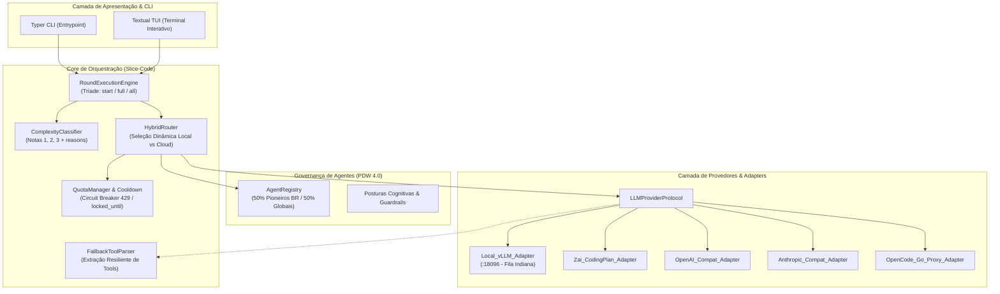

# Arquitetura do Bombe Code — Enterprise Grade v4

## 1. Visão Geral & Diretrizes de Engenharia

O **Bombe Code** é um harness de desenvolvimento de software autônomo baseado no paradigma **Slice-Code**, projetado para operar com orquestração híbrida de modelos de linguagem (LLMs locais e cloud), garantia estrita de integridade de código via TDD fullstack e governança determinística de agentes orientada a personas especializadas (PDW 4.0).

### 1.1 Princípios Arquiteturais Inegociáveis
1. **Monolito Modular Estrito:** O domínio do Bombe Code reside integralmente em `src/bombe_code/`, organizado por domínios de negócio (`orchestration/`, `routing/`, `providers/`, `tools/`, `agents/`, `tui/`), vetando o agrupamento anêmico por camadas técnicas (`controllers/`, `services/`).
2. **Contratos Fortes e Zero Mocks em Produção:** Todas as fronteiras operam sobre `typing.Protocol` e validação de schema via Pydantic V2. Stores voláteis em memória são estritamente proibidas para persistência de missão e estado de cotas.
3. **Resiliência a Falhas de Provedor (Circuit Breaking):** O sistema assume a falibilidade de qualquer provedor cloud (esgotamento de cota, HTTP 429, latência anômala) e roteia dinamicamente para o cluster local sem interrupção do ciclo de queima.
4. **Fila Indiana Local (Single-Model VRAM Constrained):** O motor local aloca exatamente um modelo por vez na GPU (porta `18096`), eliminando colisão de VRAM em hardware comercial (16GB–24GB).
5. **Cadência Kanban de 1 Round = 1 Story:** Round 0 resolve o Upstream Macro (Inception, PBB, PRD, Arquitetura). Cada Round subsequente (1..N) encapsula exatamente 1 Story e seus respectivos Slices verticais executados sob ciclo Red/Green/Refactor.

### 1.2 Diagrama Arquitetural de Contêineres e Fronteiras



---

## 2. Stack Tecnológica & Justificativa Técnica

| Componente | Tecnologia Adotada | Justificativa Técnica Enterprise |
| :--- | :--- | :--- |
| **Runtime & Gestão de Dependências** | Python 3.12+ via `uv` | Resolução determinística via lockfile binário, inicialização ultrarrápida de virtualenvs e conformidade com type-hinting moderno (`PEP 695`, `typing.override`). |
| **Validação Estrutural & Schemas** | Pydantic V2 | Validação de invariantes em Rust com alta performance e coerção segura de dados em tempo de execução. |
| **Motor de Inferência Local** | vLLM (Headless HTTP na porta `18096`) | Engine com Continuous Batching e PagedAttention. Atende ao limite de VRAM comercial (16GB–24GB) através de uma **fila indiana**: exatamente um modelo carregado por vez. Modelos suportados na matriz: LFM 1.7B, Gemma 4B, Qwen 9B, Gemma 26B (quantizado AWQ/GPTQ). |
| **Interface com Usuário** | Textual 0.70+ & Typer 0.12+ | CLI scriptável para integração em CI/CD e TUI reativa com eventos assíncronos para navegação em árvore de slices e logs de streaming de tokens. |
| **Comunicação HTTP & Streaming** | `httpx` (AsyncClient com SSE) | Suporte nativo a HTTP/2, streaming assíncrono de Server-Sent Events e pooling de conexões reutilizáveis. |

---

## 3. Modelo de Dados & Estado de Runtime

### 3.1 Configuração Unificada de Provedores (`.bombeconfig` & `providers.yaml`)

```yaml
# Estrutura persistida em .bombeconfig e ~/.local/share/bombe-code/providers.yaml
providers:
  local_vllm:
    base_url: "http://127.0.0.1:18096/v1"
    active_model: "qwen-9b-instruct"
    supported_models:
      - name: "lfm-1.7b"
        tier: "junior"
        vram_mb: 3200
      - name: "gemma-4b"
        tier: "junior"
        vram_mb: 6100
      - name: "qwen-9b"
        tier: "pleno"
        vram_mb: 11500
      - name: "gemma-26b-awq"
        tier: "senior"
        vram_mb: 18500
  cloud_zai:
    provider_type: "zai"
    api_key_env: "ZAI_API_KEY"
    base_url: "https://api.z.ai/v1"
    models: ["glm-4-plus", "glm-4-flash"]
    tier: "senior"
  cloud_openai:
    provider_type: "openai_compat"
    api_key_env: "OPENAI_API_KEY"
    base_url: "https://api.openai.com/v1"
    models: ["gpt-4o", "gpt-4o-mini"]
  cloud_anthropic:
    provider_type: "anthropic"
    api_key_env: "ANTHROPIC_API_KEY"
    models: ["claude-3-5-sonnet-20241022", "claude-3-5-haiku-20241022"]
  opencode_go:
    provider_type: "opencode_proxy"
    base_url: "http://127.0.0.1:4096/v1"
    tier: "pleno"
```

### 3.2 Gerenciamento de Cotas e Cooldown (`quota_state.json`)

Para evitar chamadas nulas que travam o ciclo TDD, o `QuotaManager` registra o estado de exaustão e programa um Circuit Breaker com reavaliação periódica:

```json
{
  "updated_at": "2026-10-31T15:30:00Z",
  "providers": {
    "cloud_zai": {
      "status": "exhausted",
      "consecutive_failures": 3,
      "last_error_code": 429,
      "last_error_message": "Insufficient balance or rate limit exceeded.",
      "locked_until": "2026-10-31T18:30:00Z"
    },
    "local_vllm": {
      "status": "healthy",
      "consecutive_failures": 0,
      "last_error_code": null,
      "locked_until": null
    }
  }
}
```

### 3.3 Esquema de Slices e Avaliação de Complexidade

Cada Slice gerado na Fase 1 (Upstream) possui metadados determinísticos de complexidade:

```json
{
  "slice_id": "SLICE-01",
  "story_id": "STORY-01",
  "round_id": "ROUND-1",
  "title": "Criação do Protocolo LLMProviderProtocol e Adapter vLLM",
  "complexity_score": 2,
  "complexity_reasons": [
    "Interface estrutural com streaming assíncrono",
    "Tratamento de reconexão de sockets HTTP locais",
    "Volume de linhas estimado < 150 linhas sem alteração de schema externo"
  ],
  "recommended_tier": "pleno",
  "target_execution": "local_vllm"
}
```

**Critérios de Classificação:**
- **Nota 1 (Júnior):** Alteração cosmética, documentação, testes unitários isolados, funções utilitárias puras (< 50 linhas, 0 acoplamento externo).
- **Nota 2 (Pleno):** Implementação de contrato, CRUD bem definido, refatoração interna de módulo, testes de integração sem concorrência (50 a 200 linhas).
- **Nota 3 (Sênior / Lead):** Mudanças estruturais de arquitetura, concorrência, migrações de schema, contratos de rede distribuídos, lógica crítica de segurança ou roteamento (> 200 linhas ou impacto cross-module).

### 3.4 Modelo de 1 Round = 1 Story

```
ROUND 0: Upstream Macro
├── mission.md
├── prd/prd.md
├── architecture/architecture.md
└── epics/ & stories/ (Definição Base)

ROUND 1: Execução da Story 1 (Story-01)
├── Upstream Técnico: Detalhamento, Refinamento e Fatiamento em Slices (1..M)
├── Downstream: Queima TDD Slice a Slice (Red -> Green -> Refactor)
└── Validate: Code Review da Story Completa por @unclebob + Hard Gate de Commit

ROUND 2: Execução da Story 2 (Story-02)
...
```

---

## 4. Componentes Arquiteturais e Contratos de Interface

### 4.1 Contrato de Provedor (`LLMProviderProtocol`)

```python
from __future__ import annotations
from dataclasses import dataclass
from typing import Any, AsyncIterator, Protocol, runtime_checkable

@dataclass(frozen=True)
class ToolCallChunk:
    id: str
    name: str
    arguments: str

@dataclass(frozen=True)
class CompletionChunk:
    delta_text: str
    tool_calls: list[ToolCallChunk] | None = None
    finish_reason: str | None = None

@runtime_checkable
class LLMProviderProtocol(Protocol):
    """Contrato desacoplado para qualquer motor de inferência (local ou cloud)."""

    async def stream_chat(
        self,
        messages: list[dict[str, Any]],
        tools: list[dict[str, Any]] | None = None,
        system_prompt: str | None = None,
        temperature: float = 0.2,
    ) -> AsyncIterator[CompletionChunk]:
        """Emite chunks da resposta em tempo real via streaming assíncrono."""
        ...

    async def check_health(self) -> bool:
        """Verifica a disponibilidade imediata do endpoint."""
        ...
```

### 4.2 Classificador de Complexidade (`ComplexityClassifier`)

```python
from pydantic import BaseModel, Field

class ComplexityAnalysis(BaseModel):
    score: int = Field(ge=1, le=3, description="Nota de complexidade: 1, 2 ou 3")
    reasons: list[str] = Field(min_length=1, description="Justificativas técnicas auditáveis")
    recommended_tier: str = Field(pattern="^(junior|pleno|senior)$")

class ComplexityClassifier:
    """Calcula deterministicamente a complexidade do slice com base em regras e AST."""

    def evaluate_slice(self, slice_spec: dict[str, Any]) -> ComplexityAnalysis:
        reasons: list[str] = []
        scope = slice_spec.get("scope", "").lower()
        files = slice_spec.get("affected_files", [])

        if any("protocol" in f or "engine" in f or "router" in f for f in files):
            reasons.append("Toca o núcleo de orquestração ou interfaces fundamentais.")
            return ComplexityAnalysis(score=3, reasons=reasons, recommended_tier="senior")

        if len(files) > 3 or "integration" in scope:
            reasons.append("Operação cross-file ou integração de módulos.")
            return ComplexityAnalysis(score=2, reasons=reasons, recommended_tier="pleno")

        reasons.append("Operação de escopo isolado de baixa complexidade cognitiva.")
        return ComplexityAnalysis(score=1, reasons=reasons, recommended_tier="junior")
```

### 4.3 Roteador Híbrido (`HybridRouter`)

O roteador aplica uma estratégia estrita:
1. **Entrada:** Nota de complexidade (1, 2, 3) + Estado do Provedor (`QuotaManager`).
2. **Prioridade Inicial:**
   - Score 1 (Júnior) -> `local_vllm` (LFM 1.7B ou Gemma 4B).
   - Score 2 (Pleno) -> `local_vllm` (Qwen 9B) ou `cloud_zai` (modo flash).
   - Score 3 (Sênior/Lead) -> `cloud_zai` (GLM-4-Plus) / `cloud_anthropic` (Claude 3.5 Sonnet) / `local_vllm` (Gemma 26B se VRAM disponível).
3. **Mecanismo de Fallback por Cota:** Se o provedor cloud preferencial retornar 429 ou estiver em `locked_until`, o router efetua **fallback imediato** para o melhor modelo local disponível daquele tier, emitindo alerta estruturado nos logs.

### 4.4 Fallback Tool Parser (`FallbackToolParser`)

Modelos locais menores frequentemente falham em emitir chamadas de tool via campos nativos da API e emitem JSON em blocos markdown (````json ... ````) ou no corpo do texto. O `FallbackToolParser` atua como interceptador transparente:

```python
import json
import re
from typing import Any

class FallbackToolParser:
    """Recupera tool-calls estruturadas emitidas em texto puro/markdown por modelos compactos."""

    _PATTERN = re.compile(r"```(?:json)?\s*(\{\s*[\"']tool[\"']\s*:.*?\})\s*```", re.DOTALL)

    def extract_tools(self, content: str) -> list[dict[str, Any]]:
        extracted: list[dict[str, Any]] = []
        matches = self._PATTERN.findall(content)
        for block in matches:
            try:
                data = json.loads(block)
                if "tool" in data and "arguments" in data:
                    extracted.append({
                        "name": data["tool"],
                        "arguments": data["arguments"]
                    })
            except json.JSONDecodeError:
                continue
        return extracted
```

### 4.5 Motor de Execução de Rounds (`RoundExecutionEngine`)

Implementa deterministicamente a tríade de comandos exigida pela Constituição:
- `round-start [round]`: Inicializa o Upstream, valida bloqueios de DOR, cria estrutura de diretórios e para no portão de aprovação.
- `round-full [round]`: Executa Upstream + Downstream (Queima dos Slices via TDD) + Validate da Story completa para aquele round, sem saltar para o próximo.
- `round-all`: Orquestra iterativamente a missão do primeiro ao último round pendente, com paradas exclusivas para falhas críticas de compilação ou testes.

---

## 5. Architecture Decision Records (ADRs)

### ADR-01: Adoção do Pipeline Slice-Code e Modelo 1 Round = 1 Story
- **Status:** APPROVED.
- **Contexto:** O Bombe Code nasceu sob o modelo antigo `tdd-code`. O Bombe Core migrou para o workflow MISSION sob `slice-code`. Rounds com múltiplas stories sobrecarregam o code review e aumentam a chance de drift arquitetural.
- **Decisão:** Unificar a estrutura sob `slice-code` fixando que cada Round de execução (1..N) atenderá exatamente a 1 Story. O Round 0 permanece dedicado à Inception Macro e PBB.
- **Trade-offs:** Rounds tornam-se menores e mais frequentes. O overhead de inicialização de round é mitigado pela automação contínua do `RoundExecutionEngine`.
- **Consequências:** Revisão de código de granularidade atômica por story pelo @unclebob; facilidade imediata de rollback; compatibilidade 100% com o Bombe Core v4.

### ADR-02: Roteamento Híbrido Orientado à Complexidade de Slice e Fallback por Cota
- **Status:** APPROVED.
- **Contexto:** Limitações de orçamento e instabilidades em APIs externas (como a cota estourada na Z.ai) exigem um mecanismo dinâmico que decida quando usar LLMs locais e quando pagar por tokens cloud.
- **Decisão:** Classificar cada slice com nota 1, 2 ou 3 e rotear para o tier correspondente. Implementar um Circuit Breaker com `locked_until` no `QuotaManager` para degradar graciosamente para o cluster local sem abortar a missão.
- **Trade-offs:** Modelos locais podem ter menor precisão de raciocínio se mal calibrados; isso é compensado pela redução do escopo do slice e pelo `FallbackToolParser`.
- **Consequências:** Execução ininterrupta de tarefas mesmo sem conexão ou saldo de API; economia agressiva de custos operacionais.

### ADR-03: Fila Indiana de Servidores Locais na Porta 18096
- **Status:** APPROVED.
- **Contexto:** Usuários e desenvolvedores dispõem de hardware comercial com GPUs de 16GB a 24GB VRAM. Rodar múltiplos servidores LLM concorrentes causa estouro de memória (CUDA Out Of Memory - OOM).
- **Decisão:** Fixar uma única porta local (`18096`) para o motor vLLM, com gerenciamento em fila indiana: exatamente um modelo ativo na VRAM por vez. Trocas de modelo ocorrem via stop/swap controlado pelo harness.
- **Trade-offs:** Pequena latência de troca de modelo (warmup de 5 a 15 segundos) quando há transição de tier entre slices.
- **Consequências:** Zero risco de travamento de GPU por OOM; estabilidade operacional em hardware acessível.

### ADR-04: Fallback Parser Resiliente de Tool Calling
- **Status:** APPROVED.
- **Contexto:** Modelos compactos (LFM 1.7B, Gemma 4B, Qwen 9B) têm suporte irregular a function calling nativo no padrão OpenAI JSON, emitindo payloads válidos embutidos no corpo markdown.
- **Decisão:** Implementar middleware de parsing de streaming que detecta padrões de tool call no texto, normaliza o payload e entrega objetos `ToolCallChunk` consistentes ao motor de execução.
- **Trade-offs:** Custo desprezível de parsing com Regex/JSON por chunk de resposta.
- **Consequências:** Modelos locais menores tornam-se aptos a orquestrar tools de arquivo, terminal e testes sem rejeição do harness.

### ADR-05: Preservação dos Nomes dos Agentes com Postura Cognitiva PDW 4.0
- **Status:** APPROVED.
- **Contexto:** O Bombe Code possui identidade única em seu catálogo de agentes (50% Pioneiros Brasileiros de TI e 50% Mundiais). O usuário ordenou expressamente manter os nomes originais, mas atualizá-los para a Postura Cognitiva do PDW 4.0.
- **Decisão:** Preservar a nomenclatura canônica dos agentes existentes (`@meira`, `@ieru`, `@barreto`, `@diego`, `@guto`, `@caroli`, `@valim`, `@aniche`, `@edith`, `@demi`, `@claudia`, `@nelson`, `@nina`, etc.) aplicando internamente os 6 pilares de governança comportamental, temperamento cético adversarial e restrições de soberania do PDW 4.0.
- **Trade-offs:** Mapeamento explícito entre handles locais e subagentes do harness.
- **Consequências:** Preservação do patrimônio histórico do projeto sem abrir mão do rigor técnico do Bombe Core v4.

---

## 6. Barreiras de Segurança, Limites de Recursos & Tratamento de Erros

### 6.1 Proteção contra Esgotamento de Memória (OOM Guardian)
- O `LocalVllmManager` consulta a VRAM via `nvidia-smi` / `torch.cuda` antes de subir qualquer modelo.
- Se o modelo requisitado exigir mais que a VRAM livre restante, o sistema descarta o modelo anterior da VRAM antes de carregar o novo.
- Porta `18096` possui healthcheck ativo (`GET /health`) com timeout rígido de 2.0s.

### 6.2 Prevenção contra Desvios de Governança e Acesso a Arquivos Sensíveis
- Todos os tool-calls de modificação de sistema operacional são interceptados pelo `PermissionService`.
- Vetado terminantemente o commit ou alteração de pastas de runtime (`.agents/`, `CLAUDE.md`, `.bombeconfig`) por agentes durante a queima de histórias de negócio.
- O código produzido deve residir estritamente em `src/bombe_code/` e os testes em `tests/`.

### 6.3 Matriz de Tratamento de Exceções

| Código / Cenário | Ação do Sistema | Provedor de Destino |
| :--- | :--- | :--- |
| **HTTP 429 (Cloud Quota)** | Registra `locked_until` (TTL: 3h) no `quota_state.json` | Fallback para `local_vllm` no tier Pleno/Sênior |
| **Connection Refused :18096** | Dispara script de autoinicialização do modelo vLLM correspondente | Retentativa com backoff exponencial (3x) |
| **Tool Call Malformado** | Encaminha para `FallbackToolParser` | Converte Markdown JSON para ToolCall regular |
| **Test Failure no Ciclo TDD** | Bloqueia avanço de Slice | Mantém ciclo RED e reincorpora persona dev para correção |
