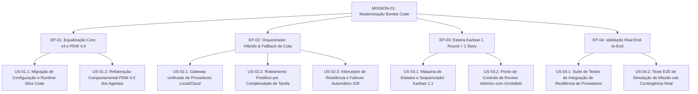

# Product Requirements Document (PRD) — MISSION-01
## Modernização do Bombe Code: Core v4, Orquestrador Híbrido & Esteira Kanban

---

## 1. Problema de Negócio & Dores Mapeadas

1. **Incompatibilidade Metodológica e Descontinuidade do tdd-code:**
   - O repositório do Bombe Code permaneceu ancorado no modelo legado `tdd-code`, que foi extinto no framework Bombe Core v4. Essa defasagem impede o uso das novas diretrizes de engenharia, governança e alinhamento com os padrões modernos de esteira corporativa.
2. **Dependência Crítica e Fragilidade de Provedores Cloud:**
   - Atualmente, o harness depende quase que exclusivamente de chamadas de APIs em nuvem. No momento da demanda, chaves configuradas (como Z.AI) encontram-se com cota esgotada (HTTP 429), gerando bloqueio total do ciclo de desenvolvimento na ausência de um mecanismo de failover automático para instâncias locais.
3. **Custo Excessivo e Ineficiência com Modelos Proprietários:**
   - O consumo desregulado de tokens cloud para geração de código mecânico, inspeção estática e testes unitários gera custos financeiros elevados e desnecessários que poderiam ser 80%+ absorvidos por hardware local.
4. **Sobrecarga Cognitiva em Rounds Monolíticos:**
   - No modelo anterior, um round agrupava múltiplas histórias complexas simultaneamente. Isso gerava janelas de contexto saturadas para os agentes de auditoria (@unclebob e @hoare), elevava a taxa de retrabalho e aumentava o Lead Time para validação de valor.

---

## 2. Objetivos e Não-Objetivos

### 2.1. Objetivos da Missão
- **Equalizar o Runtime:** Adequar a configuração do Bombe Code (`.bombeconfig`) e a estrutura de execução para o modo `slice-code`, incorporando a maturidade PDW 4.0 em todos os subagentes.
- **Implementar o Smart LLM Router:** Criar um orquestrador híbrido que classifique tarefas por heurística de complexidade e execute failover instantâneo para modelos locais quando chamadas cloud retornarem erros de cota (429) ou indisponibilidade.
- **Estabelecer a Esteira Kanban 1:1:** Simplificar o sequenciador de execução de forma que cada Round de trabalho corresponda a exatamente 1 Story de backlog, mantendo o fatiamento em Slices (Backend TDD + Frontend Construction).
- **Provar a Resiliência em Cenário Real:** Executar a suíte de testes ponta a ponta demonstrando a recuperação imediata de uma chamada à API Z.AI estourada, direcionando a carga para inferência local com sucesso.

### 2.2. Não-Objetivos
- Não renomear os agentes históricos do ecossistema Bombe Code (manter nomes do produto, alterando apenas a mecânica interna comportamental).
- Não alterar as leis de ferro de Slices do Bombe Core (o fatiamento vertical TDD backend e construção de UI continua intacto dentro de cada story).
- Não construir interface gráfica web ou serviços em nuvem externos para hospedar modelos; a solução deve ser autocontida e local.

---

## 3. Mapeamento de Épicos e User Stories (PBB)

### Épico EP-01: Equalização Core v4 e PDW 4.0
- **US-01.1 — Migração de Configuração e Runtime:**
  - *Como* operador do Bombe Code,
  - *Quero* que o arquivo de configuração e a inicialização adotem o modo `slice-code` com histórico de migração preservado,
  - *Para que* o sistema execute os comandos e convenções modernas do Bombe Core v4.
- **US-01.2 — Refatoração Comportamental PDW 4.0 dos Agentes:**
  - *Como* orquestrador de missões,
  - *Quero* que todos os subagentes carreguem prompts e diretrizes alinhados ao PDW 4.0 mantendo seus nomes consagrados,
  - *Para que* atuem com rigor técnico, posturas cognitivas blindadas e sem alucinações de escopo.

### Épico EP-02: Orquestrador Híbrido de LLMs & Fallback de Cota
- **US-02.1 — Gateway Unificado de Provedores:**
  - *Como* subsistema de inferência do Bombe Code,
  - *Quero* uma interface agnóstica de comunicação com múltiplos backends (Ollama/vLLM local, OpenAI, Anthropic, Z.AI),
  - *Para que* o core do harness não conheça detalhes de implementação dos protocolos de transporte.
- **US-02.2 — Roteamento Preditivo por Complexidade de Tarefa:**
  - *Como* gestor de custos e throughput,
  - *Quero* que tarefas sejam analisadas e recebam uma pontuação de complexidade (1 a 10),
  - *Para que* tarefas simples/médias (score <= 6) sejam direcionadas para modelos locais e apenas itens complexos (score >= 7) usem cloud.
- **US-02.3 — Interceptor de Resiliência e Failover Automático:**
  - *Como* desenvolvedor executando uma missão crítica,
  - *Quero* que o gateway intercepte respostas HTTP 429 (Too Many Requests / Quota Exceeded) de provedores cloud e redirecione a requisição automaticamente para o modelo local,
  - *Para que* o fluxo de trabalho nunca seja interrompido por exaustão financeira ou de taxa.

### Épico EP-03: Esteira Kanban 1 Round = 1 Story
- **US-03.1 — Máquina de Estados e Sequenciador Kanban 1:1:**
  - *Como* desenvolvedor do framework,
  - *Quero* que o orquestrador estruture os rounds de execução de modo que cada round contenha exatamente 1 Story,
  - *Para que* o ciclo de entrega seja enxuto, transparente e de fácil inspeção no quadro Kanban.
- **US-03.2 — Ponto de Controle de Review Atômico com UncleBob:**
  - *Como* auditor de qualidade e arquitetura (@unclebob),
  - *Quero* inspecionar o fechamento de cada round contendo apenas o diff de 1 Story,
  - *Para que* o code review seja minucioso, rápido e não sobrecarregue a janela de contexto.

### Épico EP-04: Validação Real End-to-End
- **US-04.1 — Suíte de Testes de Integração de Resiliência de Provedores:**
  - *Como* engenheiro de testes,
  - *Quero* testes automatizados que simulem falhas controladas de rede e rejeição de cota da Z.AI,
  - *Para que* o comportamento de failover para o backend local seja validado com determinismo.
- **US-04.2 — Teste E2E de Simulação de Missão sob Contingência Real:**
  - *Como* product manager,
  - *Quero* executar uma simulação completa de round onde uma chamada cloud falha e a story é concluída com sucesso via LLM local,
  - *Para que* haja evidência documental de valor e robustez para homologação da MISSION-01.

---

## 4. Critérios de Aceite Globais

- **CA-01 (Governança):** O arquivo `.bombeconfig` deve conter `mode: slice-code`, `mode_origin: tdd-code`, e passar sem alertas pelo verificador de configuração.
- **CA-02 (Roteamento Inteligente):** Tarefas de geração de testes de unidade e refatoração de código com score de complexidade <= 6 devem ser enviadas por padrão para o endpoint local configurado (ex: Ollama).
- **CA-03 (Tolerância a Falhas e Failover):** Ao simular ou receber retorno 429/cota esgotada de um provedor cloud, o sistema deve:
  - Registrar log de advertência estruturado informando o evento de cota esgotada.
  - Comutar o despacho para o provedor local de contingência em menos de 2000 milissegundos.
  - Concluir a requisição sem lançar exceções não tratadas ao usuário.
- **CA-04 (Mapeamento 1:1):** O sequenciador não deve permitir rounds com múltiplas stories. Cada diretório de round (`rounds/round-NN/`) conterá metadados apontando para exatamente uma história ativa.
- **CA-05 (Qualidade Enterprise):** Zero mocks de fachada em código produtivo; 100% dos testes da suíte passando em ambiente de homologação limpo.

---

## 5. Métricas de Sucesso & North Star

### North Star Metric (NSM)
> **Taxa de Continuidade Autônoma de Slices:**  
> **>= 99.5%** dos slices executados até o estado `done` sem nenhuma paralisação decorrente de falha, rate limit ou esgotamento de créditos de provedores de IA externos.

### Métricas Secundárias de Sucesso
1. **Redução de Despesa com Tokens (FinOps):** Redução mínima de **80%** no custo consolidado de tokens cloud medido após 10 stories completadas.
2. **Tempo de Failover de Provedor (MTTR Local):** Comutação Cloud → Local em tempo inferior a **2,0 segundos** em resposta a status HTTP 429.
3. **Cycle Time de Code Review:** Redução de **40%** no tempo despendido por story na subfase de review graças ao escopo atômico 1:1.
4. **Taxa de Paridade PDW:** 100% dos prompts de agentes auditados em conformidade com as diretrizes do PDW 4.0.

---

## 6. Tabela de Decisões Estratégicas de Produto

| ID | Decisão de Produto | Alternativa Rejeitada | Racional Estratégico (Valor vs. Custo) |
| :--- | :--- | :--- | :--- |
| **DP-01** | Adotar 1 Round = 1 Story no Kanban | Manter rounds agrupando 2 a 5 stories por épico | O agrupamento gerava sobrecarga na auditoria do @unclebob e aumentava o risco de quebra de testes em cascata. O modelo 1:1 traz cadência fluida e feedback imediato. |
| **DP-02** | Roteador com failover dinâmico Cloud → Local | Bloquear a esteira e exigir recarga de créditos | Exigir recarga manual paralisa o desenvolvedor e fere o princípio da autonomia. O modelo local garante entrega contínua a custo marginal zero. |
| **DP-03** | Preservar nomes históricos dos agentes locais | Forçar renomeação para nomes literais do Bombe Core | A mudança de nomes quebraria a memória operacional e scripts do time, gerando atrito sem ganho técnico. O valor está no comportamento (PDW 4.0), não no rótulo. |
| **DP-04** | Classificação de complexidade por heurística interna | Consultar uma LLM cloud para avaliar a complexidade | Usar uma LLM para decidir se deve usar LLM adiciona latência, custo de rede e o próprio risco de 429 que queremos evitar. Heurísticas baseadas em tipo de tarefa e tamanho de diff são instantâneas e confiáveis. |
