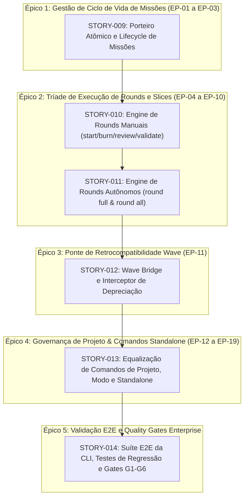

# Product Requirements Document (PRD) — MISSION-02

## 1. Problema da Missão

### 1.1. Contexto e Diagnóstico
O Bombe Code evoluiu como uma ferramenta de terminal de alta potência para orquestração de IA. Contudo, seu subconjunto de comandos e runtime de esteira mantinham forte acoplamento com versões preliminares do Bombe Core, apresentando as seguintes debilidades estruturais:

1. **Assimetria de Comandos e Protocolos:** Enquanto o Bombe Core v4 opera sob a esteira padronizada de Missões e Tríade de Rounds (`round-start`, `round-full`, `round-all`), o Bombe Code expunha rotinas mistas e comandos incompletos que forçavam o desenvolvedor a lembrar sintaxes divergentes.
2. **Passivo Conceitual da "Onda" (Wave):** O conceito de onda agrupava grandes blocos de tarefas em lote, violando a regra de fatiamento atômico e gerando rounds monolíticos que sobrecarregavam a janela de contexto de revisão dos agentes (@unclebob e @hoare).
3. **Risco de Quebra em Scripts Legados:** Operadores e automações que utilizavam a sintaxe `bombe wave ...` ficariam órfãos caso o suporte fosse removido de forma abrupta.
4. **Falta de Porteiro Atômico Bloqueante:** Ausência de trava rigorosa no ciclo de vida de missões, permitindo potenciais concorrências e inconsistências no diretório `docs/missions/`.

### 1.2. A Dor do Usuário
O desenvolvedor precisava alternar mentalmente entre as diretrizes metodológicas do Core v4 e os comandos efetivos do Bombe Code, resultando em atrito operacional, execuções interrompidas por confirmações vazias e incerteza sobre o estado da esteira de desenvolvimento.

---

## 2. Objetivos e Não-Objetivos da Missão

### 2.1. Objetivos Inegociáveis (Must-Have — MoSCoW)
- **OBJ-01 (Paridade 1:1 com Core v4):** Equalizar integralmente a interface CLI do Bombe Code para cobrir os 19 entry points canônicos (EP-01 a EP-19) mapeados na jornada do usuário.
- **OBJ-02 (Aposentadoria de Ondas e Adoção de Rounds/Slices):** Extirpar o conceito de "onda" do motor de execução, consolidando a esteira em **1 Round = 1 Story** com fatiamento em Slices (Backend TDD + Frontend Construction).
- **OBJ-03 (Wave Bridge com Deprecation Pedagógica):** Implementar interceptor ativo para chamadas legadas `bombe wave <cmd>`, emitindo aviso visual instrutivo via terminal e despachando automaticamente para a nova primitiva correspondente.
- **OBJ-04 (Tríade de Execução de Rounds):** Disponibilizar as três modalidades de condução de esteira: Manual (`round start`, `burn`, `review`, `validate`), Semi-Auto (`round full`) e Pipeline Contínuo Desatendido (`round all`).
- **OBJ-05 (Porteiro Atômico de Missão Única):** Garantir que a invocação de `bombe mission new` bloqueie deterministicamente se já houver uma missão aberta, preservando a integridade de `docs/missions/`.

### 2.2. Não-Objetivos Explícitos (Out of Scope)
- **NÃO-OBJ-01:** Manter o conceito de ondas como motor primário de execução ou criar suporte a "sub-ondas". Ondas tornam-se estritamente uma camada de alias/bridge.
- **NÃO-OBJ-02:** Desenvolver interfaces gráficas (GUI) ou painéis web nesta missão. O foco inegociável é a experiência CLI/TUI de alta performance.
- **NÃO-OBJ-03:** Quebrar retrocompatibilidade de scripts existentes sem aviso ou retornar código de erro fatal para comandos `bombe wave` válidos no padrão anterior.
- **NÃO-OBJ-04:** Permitir execução concorrente de múltiplas missões ativas no mesmo repositório.

---

## 3. Personas Atendidas

### 3.1. Desenvolvedor Autônomo / Operador de Terminal
- **Necessidade:** Executar a construção de software com o menor número de intervenções manuais possíveis, usufruindo do pipeline contínuo `bombe round all` sem paradas vazias de confirmação.
- **Critério de Sucesso:** A esteira avança de story em story gerando commits atômicos, parando apenas se um teste quebrar de verdade.

### 3.2. Tech Lead / Arquiteto (@unclebob)
- **Necessidade:** Auditar cada story individualmente antes da integração, garantindo que o escopo unitário (1 Round = 1 Story) impeça a introdução de código morto ou mocks em produção.
- **Critério de Sucesso:** Revisões atômicas com diff limpo e rastreabilidade total no kanban da missão.

### 3.3. Mantenedor de CI/CD & Scripts Legados
- **Necessidade:** Garantir que scripts bash/makefiles que chamam `bombe wave run` continuem funcionando sem falhas catastróficas na esteira.
- **Critério de Sucesso:** Execução bem-sucedida da esteira com log claro indicando a transição pedagógica para `bombe round all`.

---

## 4. Mapeamento de Épicos × User Stories (Cadência 1 Round = 1 Story)

Em conformidade com a Constituição do Bombe Core e o Sequenciador Geral, a MISSION-02 é estruturada em 5 Épicos, desdobrados em histórias atômicas:

### Detalhamento das User Stories

| Story ID | Épico Vinculado | Título da História | Persona | Descrição de Valor | Complexidade |
| :--- | :--- | :--- | :--- | :--- | :---: |
| `STORY-009` | `EP-01` | Porteiro Atômico e Lifecycle de Missões | Dev / Tech Lead | Implementar os comandos `bombe mission new`, `bombe mission status` e `bombe mission end`, garantindo que uma nova missão seja bloqueada se outra estiver aberta, inicializando o Round 0 em `docs/missions/NN/`. | Pleno |
| `STORY-010` | `EP-02` | Engine de Rounds Manuais com DoR Gate | Dev / Tech Lead | Implementar os comandos manuais `bombe round start` (parada determinística na DoR), `bombe round burn` (queima TDD por slice), `bombe round review` e `bombe round validate`. | Sênior |
| `STORY-011` | `EP-02` | Engine de Rounds Autônomos (Full & All) | Desenvolvedor | Implementar `bombe round full [N]` (execução semi-automática de 1 story de ponta a ponta) e `bombe round all` (pipeline contínuo hands-free sem confirmações vazias). | Sênior |
| `STORY-012` | `EP-03` | Wave Bridge e Interceptor de Depreciação | Operador Legado | Implementar o roteador `bombe wave <cmd>`, exibindo banner explicativo no terminal via Rich e redirecionando com paridade para a primitiva canônica correspondente. | Pleno |
| `STORY-013` | `EP-04` | Equalização de Comandos Standalone e Governança | Dev / Tech Lead | Atualizar e integrar comandos de suporte: `bombe project configure`, `bombe project ship [env]`, `bombe mode`, `bombe task`, `bombe rca`, `bombe review`, `bombe simplify` e `bombe status-report`. | Pleno |
| `STORY-014` | `EP-05` | Suíte E2E da CLI e Homologação de Gates G1-G6 | Tech Lead / QA | Criar suíte de testes de integração e ponta a ponta com subprocess CLI real, validando o ciclo completo de missão, tríade de rounds, bridge wave e ausência total de stubs. | Pleno |

---

## 5. Critérios de Aceite da Missão (AC-01 a AC-04)

### AC-01: Paridade Funcional Estrita da CLI (19 Entry Points)
- **Dado** que o operador invoca qualquer um dos 19 comandos catalogados na especificação (`bombe mission *`, `bombe round *`, `bombe project *`, `bombe mode`, `bombe task`, `bombe rca`, `bombe review`, `bombe simplify`, `bombe status-report`),
- **Quando** o comando é executado no terminal,
- **Então** ele deve ser despachado pelo Command Dispatcher nativo em Python, executando a ação correspondente sem erros de sintaxe ou parâmetros não reconhecidos, retornando exit code 0 em operações bem-sucedidas.

### AC-02: Aposentadoria Transparente de Waves com Bridge Ativa
- **Dado** que um script ou usuário executa um comando com sintaxe legada (ex: `bombe wave start 1`, `bombe wave run`, `bombe wave validate`, `bombe wave end`),
- **Quando** a chamada é interceptada pela CLI,
- **Então** o sistema deve:
  1. Imprimir no console um banner formatado informando a obsolescência de "ondas" em favor de "rounds e slices";
  2. Redirecionar a execução imediatamente para o comando canônico equivalente (`bombe round start 1`, `bombe round all`, etc.);
  3. Manter a integridade de saída e os mesmos efeitos colaterais nos artefatos do repositório.

### AC-03: Tríade de Execução de Rounds e Porteiro Atômico
- **Dado** o ciclo de vida operacional da missão,
- **Quando** o operador invoca `bombe mission new '<demanda>'` existindo uma missão com status `open` ou `active`,
- **Então** o comando aborta imediatamente com erro bloqueante sugerindo `bombe mission status` ou `bombe mission end`.
- **E Quando** o operador utiliza a Tríade de Rounds:
  - `bombe round start [N]` executa o upstream e **para deterministicamente na DoR**;
  - `bombe round full [N]` executa upstream, queima TDD e validação daquela story e **para ao final do round**;
  - `bombe round all` itera por todos os rounds pendentes sem interrupções vazias de cortesia.

### AC-04: Zero Regressões, Zero Stubs e Quality Gates Enterprise
- **Dado** o padrão de qualidade `enterprise-grade` sob `scope_type: legacy-parity`,
- **Quando** a suíte de testes e os linters são executados em `src/bombe_code/`,
- **Então** deve ser verificado:
  1. 100% de cobertura nos dispatchers e handlers de comando;
  2. Zero ocorrências de `NotImplementedError`, corpos vazios `pass`, ou comentários `// TODO` em código de produção;
  3. Todos os testes de integração CLI executando contra processos reais ou interfaces reais de filesystem;
  4. Satisfação integral dos quality gates G1 a G6 estabelecidos em `docs/projeto/mvp.md`.

---

## 6. Métricas de Sucesso

| Métrica | Linha de Base (Legado) | Meta da MISSION-02 | Forma de Aferição |
| :--- | :--- | :--- | :--- |
| **Latência de Despacho CLI** | ~450ms (parsing lento) | **< 120ms** para comandos síncronos | Medição via `time bombe --help` / benchmark CLI. |
| **Paridade Funcional Core v4** | ~55% dos fluxos alinhados | **100% (19/19 entry points)** | Matriz de rastreabilidade de comandos em testes automatizados. |
| **Taxa de Sucesso da Wave Bridge** | 0% (comandos quebravam) | **100% de redirecionamentos válidos** | Suíte de testes de regressão de comandos legados. |
| **Confirmações Vazias Eliminadas** | Múltiplas paradas ("Continuar?") | **0 paradas vazias em `round all`** | Execução desatendida ponta a ponta sem input no stdin. |
| **Conformidade Documental SSOT** | Arquivos manuais ou dispersos | **100% de missões com rastreabilidade física** | Verificação de integridade de frontmatters em `docs/missions/`. |

---

## 7. Decisões de Produto & Trade-offs Estratégicos

### Decisão 01: Manter Nomenclatura CLI `bombe` com Subcomandos Semânticos
- **Decisão:** Utilizar a sintaxe `bombe <domínio> <ação>` (ex: `bombe mission new`, `bombe round start`) em vez de forçar a notação de prompt `*bc <skill>` no terminal bash.
- **O Porquê:** Ferramentas de terminal consagradas no ecossistema de engenharia (como `git`, `docker`, `kubectl`) utilizam verbos e recursos desacoplados. A notação `*bc` é ideal para o chat com agentes, mas a CLI POSIX deve ser idiomática para desenvolvedores e scripts shell.
- **Alternativas Descartadas:**
  - *Criar binário `bc` replicando a sintaxe de chat:* Descartado para evitar colisões com utilitários Unix padrão (`bc` - basic calculator) e manter identidade corporativa clara.

### Decisão 02: Wave Bridge Ativa com Banner Pedagógico
- **Decisão:** Não remover os comandos `bombe wave ...` nesta versão; interceptar e despachar para `round`, exibindo um aviso educativo em console.
- **O Porquê:** A depreciação suave reduz o atrito de adoção, não quebra automações legadas já configuradas em ambientes de teste e educa o usuário sobre a nova mentalidade de Slices em tempo real.
- **Alternativas Descartadas:**
  - *Hard Deprecation com erro imediato `command not found`:* Descartado por gerar frustração e violar o princípio de paridade amigável da constituição.
  - *Manter waves em paralelo como motor duplicado:* Descartado por gerar dívida técnica insustentável e violar o preceito do Bombe Core v4.

### Decisão 03: Cadência Estrita 1 Round = 1 Story
- **Decisão:** Cada round encapsula estritamente uma única história do backlog.
- **O Porquê:** Maximiza a qualidade das auditorias de @unclebob, impede o transbordamento da janela de contexto dos modelos locais de IA e permite reversões cirúrgicas de código via Git caso uma feature falhe na homologação.
- **Alternativas Descartadas:**
  - *Rounds com lote de 3 a 5 histórias:* Descartado porque reintroduziria a lentidão e os riscos do modelo de ondas que acabamos de expurgar.

### Decisão 04: Porteiro Atômico Bloqueante no Filesystem
- **Decisão:** Rejeitar atomicamente a abertura de uma nova missão caso exista uma missão em estado não-terminal (`open`, `active`).
- **O Porquê:** Garante integridade referencial absoluta na árvore `docs/missions/`, evita condições de corrida entre agentes concorrentes e mantém a atenção do time focada na conclusão do trabalho em progresso (WIP = 1).
- **Alternativas Descartadas:**
  - *Permitir missões simultâneas com troca de contexto:* Descartado pois a alternância de contexto degrada a eficiência de engenharia e gera conflitos de branches Git locais.
