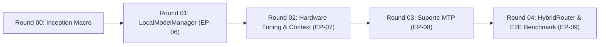

# Sequenciador de Entrega — MISSION-03

## Linha de Produção por Round

### Round 00 — Inception Macro & Alinhamento de Arquitetura
- **Artefatos:** PRD, Arquitetura Técnica, Sequenciador, Épicos, Stories Base.
- **Gate de Saída:** Validação de conformidade INVEST e DOR Processo por @david e DOR Dev por @unclebob.

### Round 01 — EP-06: LocalModelManager & Gestor de Ciclo de Vida
- **Story:** `STORY-015`
- **Foco:** Criação do launcher com binário `b11985`, Fila Indiana de subprocessos, monitor `VRAMGate` (`< 300MiB`) e endpoint health probe.
- **Entrega:** Testes unitários e de integração validando start/stop seguro.

### Round 02 — EP-07: Configurações de Hardware e Tetos de Contexto
- **Story:** `STORY-016`
- **Foco:** Implementação dos perfis de hardware (`HardwareProfile`), flags `-fa on/off`, `-ctk q8_0 -ctv q8_0`, `--n-cpu-moe 999` e tetos 128K/64K.
- **Entrega:** Validação dos comandos gerados e montagem correta de buffers de memória.

### Round 03 — EP-08: Suporte e Integração a MTP (Multi-Token Prediction)
- **Story:** `STORY-017`
- **Foco:** Orquestração dos drafts externos (`mtp-*.gguf`) para Gemma E4B e 26B, e draft nativo para Qwen 3.8-9B. Flags `--spec-type draft-mtp` e `--spec-draft-n-max`.
- **Entrega:** Execução com validação de métricas de aceleração e ausência de crash.

### Round 04 — EP-09: HybridRouter & Benchmark E2E (Token Bucket Rate Limiter)
- **Story:** `STORY-018`
- **Foco:** Conexão do `HybridRouter` com o `LocalModelManager`, execução da tarefa da POC (Token Bucket) ponta a ponta com testes unitários em pytest.
- **Entrega:** Suíte do Token Bucket 100% verde gerada sob inferência com MTP ativo.
