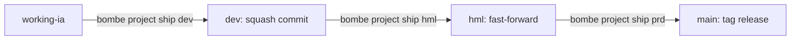

# Mapeamento de Jornadas do Usuário — Bombe Code

## 1. Visão Geral e Persona

### Persona: Desenvolvedor / Operador de Software Autônomo
- **Perfil:** Engenheiro de software sênior ou operador técnico que utiliza o harness CLI do Bombe Code para orquestração de desenvolvimento dirigida por especificações (Spec + TDD).
- **Contexto de Operação:** Terminal CLI / bash / zsh, ambiente Linux / macOS / WSL, projetos Python com Poetry/Uv/Pipenv, execução local ou híbrida (Cloud LLMs + Ollama/vLLM local).
- **Dores do Sistema Atual/Legado:**
  - Paradas manuais e loops de confirmação vazios ("Deseja continuar?").
  - Bloqueios bruscos por estouro de rate limit ou cota de APIs de terceiros.
  - Sobrecarga de conceitos legados ("ondas" com múltiplos estágios monolíticos que aumentavam o cycle time).
  - Inconsistência entre ferramentas antigas e o fluxo canônico de Rounds/Slices do Bombe Core v4.
- **Objetivos Principais:**
  - Definir demandas e gerar a fundação estrutural do projeto sem atritos (`bombe mission new`).
  - Controlar o nível de automação da esteira de acordo com a criticidade da story (Manual, Semi-Auto ou Hands-Free).
  - Execução contínua orientada a fluxo (1 Round = 1 Story fatiada em Slices Backend TDD + Frontend Construction).
  - Resiliência operacional com fallback imperceptível entre modelos em nuvem e instâncias locais (26B/9B/4B) sob exaustão de cota.
  - Retrocompatibilidade amigável com comandos de scripts legados.

---

## 2. Catálogo Geral de Entry Points CLI

| ID | Comando Canônico | Equivalente Core v4 | Tipo | Finalidade Principal |
| :--- | :--- | :--- | :--- | :--- |
| **EP-01** | `bombe mission new '<demanda>'` | `*bc project mission '<demanda>'` | CLI Direct | Inicialização formal da missão com porteiro atômico e Round 0 Upstream. |
| **EP-02** | `bombe mission status` | — | CLI Direct | Inspeção do ciclo de vida, backlog de rounds e status da missão ativa. |
| **EP-03** | `bombe mission end` | `*bc project mission end` | CLI Direct | Encerramento formal e arquivamento da missão concluída. |
| **EP-04** | `bombe round start [N]` | `*bc execute round-start [N]` | CLI Direct | Início manual controlado do round com parada determinística na DoR. |
| **EP-05** | `bombe round burn [N]` | `*bc execute round-burn [N]` | CLI Direct | Queima TDD disciplinada dos slices (RED -> GREEN -> REFACTOR). |
| **EP-06** | `bombe round review [N]` | `*bc execute round-review [N]` | CLI Direct | Auditoria formal de compliance e code review sem auto-aprovação. |
| **EP-07** | `bombe round validate [N]` | `*bc execute round-validate [N]` | CLI Direct | Validação de negócio contra critérios de aceitação e DoD. |
| **EP-08** | `bombe round full [N]` | `*bc execute round-full [N]` | CLI Direct | Execução semi-automática de uma story completa (Upstream + Burn + Validate). |
| **EP-09** | `bombe round all` | `*bc execute round-all` | CLI Direct | Pipeline contínuo desatendido para todos os rounds pendentes da missão. |
| **EP-10** | `bombe round status` | `*bc execute round-status` | CLI Direct | Exibição visual do Kanban do round, slices e gates de qualidade. |
| **EP-11** | `bombe wave <cmd>` *(legado)* | Ponte / Alias | CLI Bridge | Redirecionamento transparente para rounds/slices com aviso pedagógico de depreciação. |
| **EP-12** | `bombe project configure` | `*bc project configure` | CLI Direct | Configuração interativa de paths, stack tecnológica e modo operacional. |
| **EP-13** | `bombe project ship [env]` | `*bc project ship [env]` | CLI Direct | Promoção e merge controlado de branches (dev, hml, prd). |
| **EP-14** | `bombe mode [modo]` | `*bc mode [modo]` | CLI Direct | Alternância imediata entre `vibe-code` e `slice-code`. |
| **EP-15** | `bombe task '<desc>'` | `*bc task '<desc>'` | CLI Direct | Despacho de tarefa avulsa para subagente via Protocolo Garçom. |
| **EP-16** | `bombe rca '<incidente>'` | `*bc rca '<incidente>'` | CLI Direct | Análise de causa raiz determinística forense com @unclebob. |
| **EP-17** | `bombe review [alvo]` | `*bc review [alvo]` | CLI Direct | Code review avulso de módulo, arquivo ou branch de código. |
| **EP-18** | `bombe simplify [alvo]` | `*bc simplify [alvo]` | CLI Direct | Auditoria e refatoração para redução de complexidade de código. |
| **EP-19** | `bombe status-report` | `*bc status-report` | CLI Direct | Relatório executivo do projeto, stack, rounds e histórico de entregas. |

---

## 3. Jornadas de Interação Detalhadas

### JORNADA-01: Ciclo de Vida Canônico de Missões & Rounds (Paridade Core v4)

#### Sub-fluxo 1.1: Abertura de Missão (`bombe mission new '<demanda>'`)
```mermaid
flowchart TD
    A[Operador executa bombe mission new 'demanda'] --> B{Porteiro Atômico: Missão Ativa?}
    B -- Sim (open/active/in_progress) --> C[Erro Bloqueante: Missão Aberta Detectada]
    C --> D[Sugestão CLI: bombe mission end ou bombe mission status]
    B -- Não --> E[Criação docs/missions/NN/]
    E --> F[Inicia Round 0: Upstream Macro]
    F --> G[Agentes geram mission.md, PRD, Arquitetura e Stories BASE]
    G --> H[Status = active | Exibe resumo e próximo comando sugerido]
```
- **Comportamento & Telas:**
  - O Porteiro Atômico Bloqueante impede estados inconsistentes. Se houver missão ativa, aborta com exit code 1.
  - No caminho feliz, cria o scaffold em `docs/missions/NN/`, executa o Round 0 (Inception/PBB) e exibe o resumo em tabela Rich com os rounds planejados.

#### Sub-fluxo 1.2: A Tríade de Execução de Rounds (1 Round = 1 Story)

```mermaid
flowchart TD
    subgraph Modo Manual
        M1[bombe round start N] --> M2[Valida DoD N-1] --> M3[Upstream: Slices & DoR] --> M4[PARADA DETERMINÍSTICA NA DoR]
        M4 --> M5[bombe round burn N] --> M6[Queima TDD por Slice]
        M6 --> M7[bombe round review N] --> M8[bombe round validate N]
    end
    subgraph Modo Semi-Auto
        S1[bombe round full N] --> S2[Upstream + Queima Slices + Review + Validate] --> S3[PARADA NO FIM DO ROUND]
    end
    subgraph Modo Pipeline Contínuo
        P1[bombe round all] --> P2[Loop Sequencial por Todos os Rounds Pendentes] --> P3[Conclusão da Missão]
    end
```

- **Passos Detalhados da Esteira:**
  1. `bombe round start [N]`: Executa upstream técnico da story, detalha os critérios de aceitação, fatia em Slices verticais (Backend TDD + Frontend Construction) e **para deterministicamente na DoR**. O desenvolvedor inspeciona os slices antes da queima.
  2. `bombe round burn [N]`: Queima atômica dos slices. Para cada slice:
     - Slice Backend: Teste falhante obrigatório (RED) -> Implementação mínima (GREEN) -> Limpeza de código (REFACTOR).
     - Slice Frontend: Construção consumindo a API backend criada.
  3. `bombe round review [N]`: @hoare e @unclebob validam conformidade técnica, padrões de arquitetura e ausência de stubs/mocks em produção.
  4. `bombe round validate [N]`: @david valida regras de negócio e critérios INVEST. Se aprovado, marca round como `done`.
  5. `bombe round full [N]`: Executa os passos 1 a 4 sequencialmente para o round indicado e encerra, permitindo homologação humana de 1 Story por vez.
  6. `bombe round all`: Itera de forma contínua por todas as stories pendentes da missão, gerando commits atômicos por round sem perguntas vazias de cortesia.

#### Sub-fluxo 1.3: Encerramento de Missão (`bombe mission end`)
- Valida se todos os rounds planejados estão no estado `done`.
- Atualiza status no cabeçalho de `docs/missions/NN/mission.md` para `completed`.
- Emite sumário com métricas de tempo, quantidade de slices entregues e orienta a promoção via `bombe project ship`.

---

### JORNADA-02: Transição e Retrocompatibilidade Wave (Wave Bridge)

**Objetivo:** Permitir que operadores e scripts automatizados que utilizam a sintaxe legada (`bombe wave ...`) continuem funcionando, recebendo um aviso amigável e transparente de redirecionamento para o novo padrão de Rounds e Slices.

```mermaid
flowchart TD
    A[Operador invoca comando legado: bombe wave <subcomando>] --> B[Wave Deprecation Interceptor]
    B --> C[Emite Banner Amigável de Depreciação no Console]
    C --> D{Mapeia Subcomando Legado}
    D -- wave start [id] --> E[Executa bombe round start [num]]
    D -- wave run --> F[Executa bombe round all / round full]
    D -- wave cycle [id] --> G[Executa bombe round burn [num]]
    D -- wave validate --> H[Executa bombe round validate]
    D -- wave status --> I[Executa bombe round status]
    D -- wave promote --> J[Executa bombe project ship]
    D -- wave end --> K[Executa bombe mission end]
```

- **Tabela Canônica de Aliasing & Redirecionamento:**
  | Invocação Legada | Redirecionamento Automático | Comportamento do Bridge |
  | :--- | :--- | :--- |
  | `bombe wave start [ID]` | `bombe round start [N]` | Converte ID de onda em número de round ativo e inicia Upstream na DoR. |
  | `bombe wave run` | `bombe round all` | Executa o pipeline contínuo de rounds pendentes. |
  | `bombe wave cycle [ID]` | `bombe round burn [N]` | Queima TDD dos slices da story correspondente. |
  | `bombe wave validate` | `bombe round validate` | Executa a validação formal de aceite do round corrente. |
  | `bombe wave status` | `bombe round status` | Exibe o status consolidado de rounds, slices e gates. |
  | `bombe wave promote [env]` | `bombe project ship [env]` | Promove branches com squash em dev e fast-forward em hml/prd. |
  | `bombe wave end` | `bombe mission end` | Conclui e arquiva formalmente a missão ativa. |

- **Exemplo de Feedback Visual ao Usuário (Screen Spec):**
  ```text
  ┌─ [AVISO DE TRANSIÇÃO] ────────────────────────────────────────────────────────┐
  │ O conceito de 'ONDA' foi substituído por 'ROUNDS' e 'SLICES' no Bombe Core v4.  │
  │ Seu comando foi redirecionado automaticamente com sucesso:                     │
  │   bombe wave run  ──>  bombe round all                                        │
  │ Dica: Atualize seus atalhos para a nova sintaxe canônica 'bombe round ...'.    │
  └───────────────────────────────────────────────────────────────────────────────┘
  ```

---

### JORNADA-03: Governança de Projeto & Deploy (`bombe project`)

#### Sub-fluxo 3.1: Configuração do Projeto (`bombe project configure`)
- Lê e valida o `.bombeconfig`.
- Detecta a stack tecnológica (linguagem backend, framework frontend, caminhos de testes).
- Configura o modo operacional: `slice-code` (esteira enterprise) ou `vibe-code` (entrega leve e direta).

#### Sub-fluxo 3.2: Promoção de Branches & Ship (`bombe project ship [env]`)

- Destinos suportados: `dev` (desenvolvimento integrado), `hml` (homologação/staging), `prd` (produção).
- Executa suíte de testes de regressão antes de qualquer push remoto.

---

### JORNADA-04: Comandos Autônomos e Standalone

Operações de apoio que podem ser acionadas a qualquer momento, independente de missão ativa:

1. **`bombe mode [slice-code | vibe-code]`:**
   - Comuta o modo de operação do projeto.
   - Atualiza `mode_origin` e `mode_migrated_at` no `.bombeconfig`.
2. **`bombe task '<descrição>' [--agent @especialista]`:**
   - Executa uma tarefa técnica pontual (ex: refatorar função, gerar script de migração, testar endpoint).
   - O Orquestrador @turing despacha diretamente para o subagente nativo sem avançar estágios da missão.
3. **`bombe rca '<descrição do incidente>'`:**
   - @unclebob executa investigação forense de causa raiz (Ishikawa + 5 Porquês) e emite laudo técnico com plano de correção.
4. **`bombe review [caminho/arquivo]`:**
   - Auditoria adversarial e estrita de código por @hoare. Avalia legibilidade, cobertura de testes, segurança e conformidade arquitetural.
5. **`bombe simplify [caminho/arquivo]`:**
   - Redução de débito técnico e eliminação de complexidade ciclomática sem alterar o comportamento externo comprovado por testes.
6. **`bombe status-report`:**
   - Exibe o painel consolidado com métricas de entrega, status de git, cobertura e missões já arquivadas.

---

## 4. Matriz de Rastreabilidade e Transições de Estado

| Comando Invocado | Pré-requisito de Entrada | Transição de Estado | Artefato Persistido |
| :--- | :--- | :--- | :--- |
| `bombe mission new '<d>'` | Nenhuma missão ativa | `mission: active`, `status: open` | `docs/missions/NN/mission.md`, `prd/prd.md` |
| `bombe mission end` | Todos os rounds em `done` | `mission: completed` | `docs/missions/NN/mission.md` atualizado |
| `bombe round start [N]` | DoD do Round N-1 validado | Round N criado, parado na DoR | `docs/missions/NN/rounds/N/goal.md`, `stories.md` |
| `bombe round burn [N]` | Round N na DoR | Slices queimados (RED->GREEN->REFACTOR) | Código em `src/`, testes em `tests/` |
| `bombe round validate [N]` | Slices queimados e revisados | Round N marcado como `done` | `mission.md` e kanban do round |
| `bombe round full [N]` | DoD do Round N-1 validado | Round N executado e validado ponta a ponta | Artefatos de upstream, código e validação |
| `bombe round all` | Missão ativa | Pipeline contínuo até conclusão | Commits atômicos por round/slice |
| `bombe wave <cmd>` | Compatibilidade retroativa | Redireciona para o round/slice correspondente | Artefatos idênticos ao comando canônico |
| `bombe project ship [env]`| Testes locais passando | Merge e promoção de branch Git | Git tag e push na branch de destino |

---

## 5. Conformidade com a Constituição do Bombe Core

1. **CLI First:** Nenhuma ação do ecossistema depende de interface gráfica; 100% das decisões e feedbacks são auditáveis via terminal.
2. **Anti-Confirmações Vazias:** A esteira em modo `round-all` opera de forma contínua, parando apenas em falhas de teste reais ou impasses substantivos de especificação.
3. **Resiliência e Observabilidade:** O sistema informa claramente transições de estado, deprecation notices e interceptações de cota de inteligência artificial.
