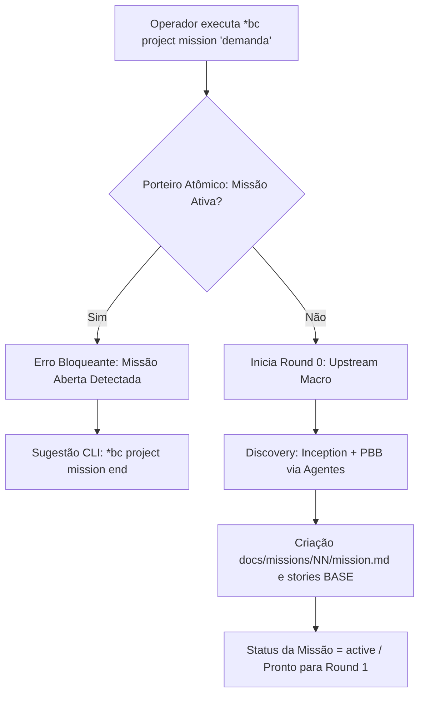
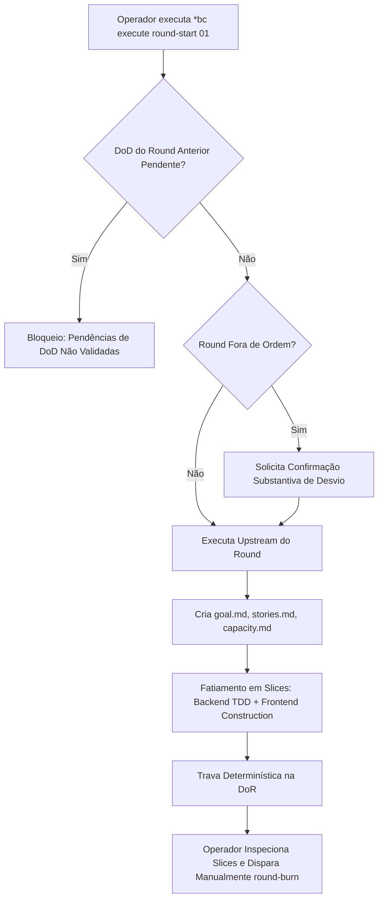
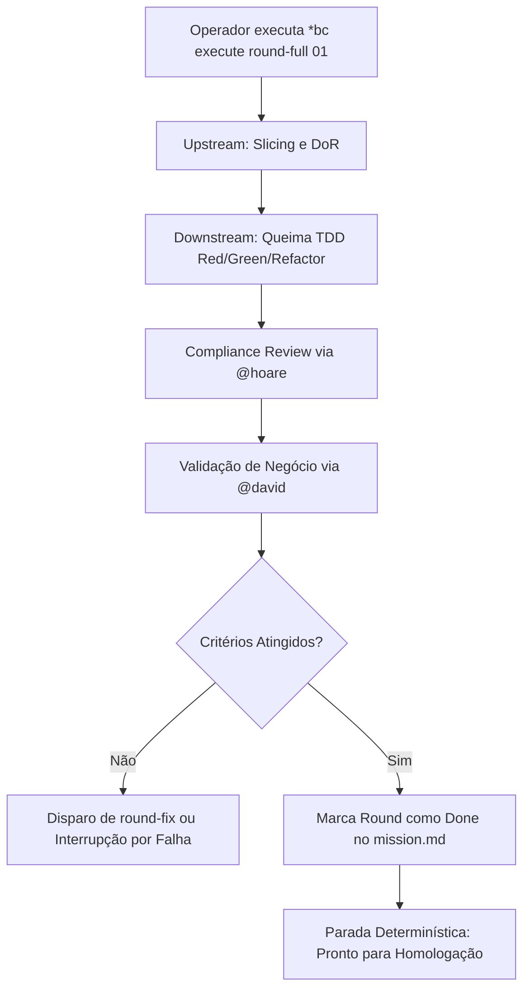
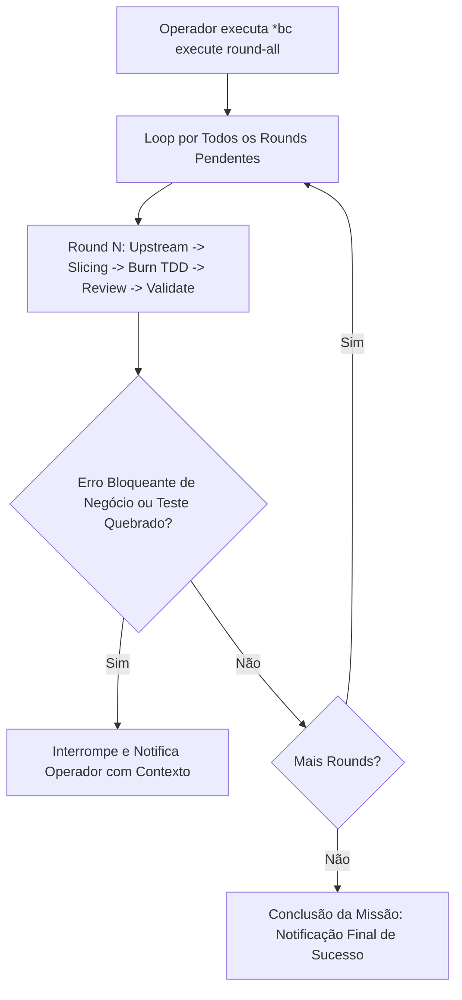
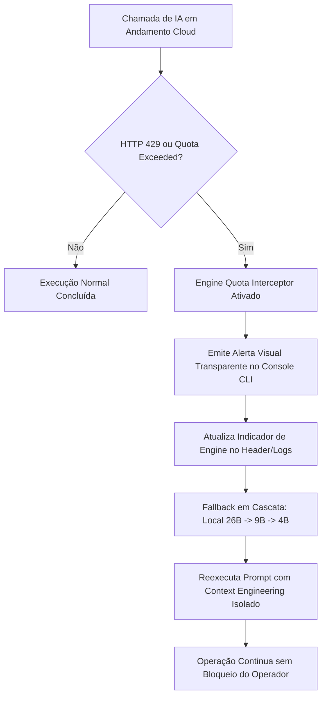

# Mapeamento de Jornadas do Usuário — Bombe Code

## 1. Visão Geral e Persona

### Persona: Desenvolvedor / Operador de Software Autônomo
- **Perfil:** Engenheiro de software sênior ou operador técnico que utiliza o harness CLI do Bombe Code para orquestração de desenvolvimento dirigida por especificações (Spec + TDD).
- **Contexto de Operação:** Terminal CLI / bash / zsh, ambiente Linux / macOS / WSL, projetos Python com Poetry/Uv/Pipenv, execução local ou híbrida (Cloud LLMs + Ollama/vLLM local).
- **Dores do Sistema Atual/Legado:**
  - Paradas manuais e loops de confirmação vazios ("Deseja continuar?").
  - Bloqueios bruscos por estouro de rate limit ou cota de APIs de terceiros.
  - Inconsistência entre planejamento da missão e execução física de stories/slices.
- **Objetivos Principais:**
  - Definir demandas e gerar a fundação estrutural do projeto sem atritos.
  - Controlar o nível de automação da esteira de acordo com a criticidade da story (Manual, Semi-Auto ou Hands-Free).
  - Resiliência operacional com fallback imperceptível entre modelos em nuvem e instâncias locais (26B/9B/4B) sob exaustão de cota.

---

## 2. Entry Points

| ID | Entry Point | Tipo | Descrição | Pré-requisitos |
| :--- | :--- | :--- | :--- | :--- |
| **EP-01** | `*bc project mission "<demanda>"` | CLI Direct | Inicialização formal do ciclo de descoberta upstream e scaffold da missão. | Workspace inicializado; ausência de missões ativas concorrentes. |
| **EP-02** | `*bc execute round-start [round]` | CLI Direct | Início manual controlado de um round específico para inspeção técnica e slicing. | Missão ativa; Round anterior validado (se sequencial). |
| **EP-03** | `*bc execute round-full [round]` | CLI Direct | Disparo semi-automático para queima e validação de uma Story inteira. | Missão ativa; DoD do round anterior concluído. |
| **EP-04** | `*bc execute round-all` | CLI Direct | Execução autônoma em pipeline contínuo de todas as stories do backlog. | Missão ativa; Round 0 (Inception/PBB) validado. |
| **EP-05** | Evento de Fallback de Cota (Engine Quota Interceptor) | Runtime Event | Transição automática orientada a evento disparada pelo esgotamento de créditos da API Cloud. | Monitoramento ativo de respostas HTTP 429/cota esgotada. |

---

## 3. Jornadas de Interação

### Jornada 1: Configuração & Inicialização de Missões (`*bc project mission`)
**Objetivo:** Estabelecer uma nova missão atômica com validação do porteiro de unicidade, gerando `docs/missions/NN/mission.md`, PRD e backlog de épicos/stories sem sobreposição.



- **Caminho Feliz (Passo a Passo):**
  1. Operador executa `*bc project mission "Construir harness com suporte a fallback de LLM"`.
  2. Sistema aciona o **Porteiro Atômico Bloqueante**: valida se não existe missão aberta (`open`, `active`, `in_progress`).
  3. Sistema aloca o identificador sequencial `docs/missions/01/`.
  4. Executa a Fase Upstream Macro (Lean Inception / PBB): define escopo, épicos e stories BASE com critérios INVEST.
  5. Persiste o scaffold: `mission.md`, PRD e definições de arquitetura.
  6. Feedback visual de sucesso emitido na CLI com sumário de stories geradas e comando recomendado para prosseguir.
- **Fluxos Alternativos:**
  - *Demanda Curta/Vibe Code:* Se o modo for `vibe-code`, a missão é criada no perfil light, registrando a demanda verbatim sem fatiamento formal de rounds.
- **Fluxos de Erro e Exceção:**
  - *Missão Ativa Concorrente:* O sistema aborta sumariamente com código de saída não-zero e mensagem: `[ERRO BLOQUEANTE] A missão NN já está aberta. Finalize-a com *bc project mission end antes de abrir nova missão.`
  - *Parâmetro de Demanda Vazio:* Alerta o operador e exibe a sintaxe padrão de invocação.

---

### Jornada 2: Execução Manual / Passo a Passo (`*bc execute round-start [round]`)
**Objetivo:** Permitir inspeção analítica profunda. O sistema executa o upstream do round, materializa os artefatos de governança e **para deterministicamente na DoR (Definition of Ready)** antes de queimar qualquer código.



- **Caminho Feliz:**
  1. Operador executa `*bc execute round-start 01`.
  2. Validador checa se o round anterior possui pendências não resolvidas (`- [ ]`).
  3. Sistema cria o diretório físico do round (`docs/missions/NN/rounds/01/`).
  4. Agente de Upstream define `goal.md`, detalha os critérios de aceitação e executa o fatiamento em Slices verticais (Backend TDD + Frontend Construction).
  5. O sistema atinge a **DoR** e para deterministicamente. Não há queima de código automática.
  6. CLI emite relatório tabular com os slices propostos e aguarda instrução manual do operador (`*bc execute round-burn`).
- **Fluxos Alternativos:**
  - *Round fora da ordem sequencial:* Se o operador especificar Round 03 com Round 02 pendente, a CLI exige confirmação explícita de desvio de fluxo antes de prosseguir.
- **Fluxos de Erro:**
  - *Violação de DoD Prévia:* Operação barrada se o round anterior estiver inconsistente ou com testes falhando.

---

### Jornada 3: Execução Semi-Auto por Story (`*bc execute round-full [round]`)
**Objetivo:** Queimar uma Story completa (1 Round = 1 Story) de ponta a ponta sem paradas intermediárias, realizando Upstream, Downstream (TDD RED/GREEN/REFACTOR), Review e Validação com parada final para homologação do operador.



- **Caminho Feliz:**
  1. Operador executa `*bc execute round-full 01`.
  2. Upstream automático: valida DoR e materializa os slices.
  3. Queima Downstream:
     - Slice Backend: escrita do teste unitário/integração (RED), código mínimo de produção (GREEN) e limpeza estrutural (REFACTOR).
     - Slice Frontend / CLI: construção e integração direta com a API/módulo recém-criado.
  4. Revisão técnica de conformidade (Quality/Compliance Gate) sem auto-review.
  5. Validação funcional da Story contra os critérios de aceitação.
  6. Sistema atualiza o status para `done` em `mission.md` e **para deterministicamente**, sem iniciar o próximo round.
- **Fluxos de Erro:**
  - *Falha em Teste de Regressão ou Quebra de Contrato:* O pipeline interrompe imediatamente a execução downstream, isola o diff e apresenta o stack trace/relatório de erro para análise.

---

### Jornada 4: Execução Hands-Free Contínua (`*bc execute round-all`)
**Objetivo:** Operação totalmente desatendida. O Bombe Code consome iterativamente todo o backlog da missão, orquestrando as estações de trabalho de cada especialista até a entrega final.



- **Caminho Feliz:**
  1. Operador executa `*bc execute round-all` no início do turno ou overnight.
  2. Sistema localiza o primeiro round pendente e aciona a esteira contínua.
  3. Para cada round:
     - Upstream -> Slicing -> Queima TDD -> Compliance -> Validação.
     - Commits atômicos gerados por round/slice.
  4. Ao validar o Round N, o orquestrador transiciona de imediato para o Round N+1 sem confirmações de cortesia.
  5. Após o último round validado, a esteira encerra, emite sumário estatístico de tempo e commits, e atualiza a missão para status pronto para encerramento (`*bc project ship`).
- **Fluxos de Erro e Proteções:**
  - *Impasse Substantivo:* Se um teste persistir vermelho após retentativas ou se houver contradição de especificação, o pipeline pausa de forma segura, mantendo o workspace estável e solicitando decisão humana.

---

### Jornada 5: Feedback de Cota e Observabilidade
**Objetivo:** Garantir resiliência contra exaustão de limites de API externa (Z.ai/OpenAI/Anthropic). O harness intercepta a indisponibilidade de cota e redireciona a computação para instâncias locais (26B -> 9B -> 4B) de forma transparente e observável.



- **Caminho Feliz:**
  1. Durante a queima de um slice em `round-all` ou `round-full`, o provedor em nuvem retorna erro de cota esgotada (ex: HTTP 429 ou saldo insuficiente na Z.ai).
  2. O **Engine Quota Interceptor** detecta o status determinístico da resposta.
  3. O console CLI renderiza imediatamente um banner informativo de observabilidade:
     ```
     [QUOTA ALERT] Cota Cloud esgotada. Chaveando engine automaticamente:
     Provider: Cloud (API) -> Local Ollama/vLLM (Model: gemma-2-27b ou qwen-2.5-coder-7b/32b)
     Status: Operação contínua e sem perda de contexto.
     ```
  4. O harness adapta o envelope de contexto e submete a requisição ao modelo local.
  5. A esteira continua seu trabalho sem interrupção do operador e sem abortar o round.
- **Fluxos Alternativos (Degradação Graciosa em Cascata):**
  - *Sobrecarga de VRAM / Falta de Modelo 26B:* Caso a máquina do operador não suporte o modelo de 26B, o interceptor chaveia automaticamente para o modelo de 9B e, se necessário, para o modelo de 4B ultra-leve, mantendo o operador ciente das capacidades e métricas de inferência.
- **Fluxos de Erro:**
  - *Inoperância Total de Motores (Cloud e Local Offline):* Se os serviços locais estiverem inacessíveis, o sistema suspende o round com mensagem clara de recuperação: `[FALHA DE ENGINE] Provedor Cloud sem cota e runtime local inacessível em localhost:18096. Inicie o vLLM local ou configure novas credenciais para retomar.`

---

## 4. Matriz de Transição e Integrações de Sistema

| Origem | Gatilho / Ação | Destino / Estado do Sistema | Integrações Críticas |
| :--- | :--- | :--- | :--- |
| **Idle Workspace** | `*bc project mission "<demanda>"` | `mission: active` (`docs/missions/01/`) | Sistema de arquivos local, `.bombeconfig`, analisador de escopo upstream. |
| **Mission Active** | `*bc execute round-start [N]` | Round N materializado, parado na **DoR** | Parser de dependências, verificador de DoD do Round N-1, criador de slices. |
| **DoR Validada** | `*bc execute round-burn [N]` | Slices implementados (RED -> GREEN -> REFACTOR) | Test runners (pytest/unittest), ferramentas de linters e git. |
| **Round Validado** | `*bc execute round-full [N]` | Round N marcado como `done` em `mission.md` | Estações de QA (@david, @hoare), integridade de arquivos do round. |
| **Backlog Ativo** | `*bc execute round-all` | Todos os rounds em `done` | Orquestrador de rounds contínuos, pipeline multi-estação. |
| **Cloud Quota Exceeded** | HTTP 429 / Insufficient Quota | Fallback local ativado (26B/9B/4B) | vLLM/Ollama local na porta 18096, buffers de logs de observabilidade, Telemetria CLI. |

---

## 5. Rastreabilidade de Artefatos & Conformidade

- **Alinhamento com a Constituição:**
  - *CLI First:* Todas as interações ocorrem exclusivamente no terminal.
  - *Anti-Confirmações Vazias:* O fluxo contínuo avança sem perguntas de confirmação desnecessárias, parando exclusivamente em impasses substantivos ou gates formais de DoR/Validação.
  - *Resiliência Operacional:* A transição entre modelos locais e em nuvem preserva o estado da missão em `docs/missions/NN/` sem corromper o histórico do TDD.
