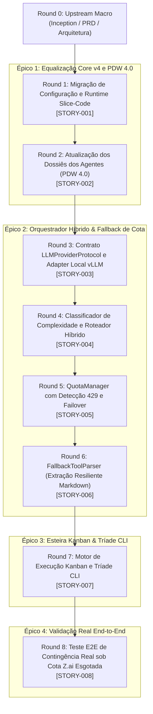

# Sequenciador Geral de Entregas — Bombe Code

## 1. Princípio Motor: Cadência Kanban 1 Round = 1 Story

O Bombe Code opera sob o modelo de **1 Round = 1 Story**. 
- O **Round 0** é dedicado exclusivamente ao Upstream Macro (Lean Inception, PBB, PRD, Arquitetura e Sequenciamento Geral).
- Os **Rounds 1 a 8** são executados de forma sequencial e unívoca: cada round absorve exatamente uma história de ponta a ponta (Upstream Técnico da Story -> Fatiamento em Slices -> Queima TDD Downstream -> Code Review & Validação de DoD por @unclebob).

---

## 2. Matriz de Sequenciamento dos Rounds (1 a 8)

| Round | Story ID | Épico | Título da História | Complexidade | Agente Principal | Dependências | Desbloqueio de Valor |
| :---: | :---: | :---: | :--- | :---: | :---: | :--- | :---: | :--- |
| **R-1** | `STORY-001` | `EP-01` | Migração de Configuração e Runtime Slice-Code | Nota 1 (Júnior) | @fowler | Round 0 | Saneamento do `.bombeconfig` e expurgo definitivo do modelo legado `tdd-code`. |
| **R-2** | `STORY-002` | `EP-01` | Atualização dos Dossiês dos Agentes para PDW 4.0 Preservando Nomes | Nota 1 (Júnior) | @andrej | `STORY-001` | Agentes operam sob rigor comportamental e guardrails do PDW 4.0 sem quebra de nomenclatura histórica. |
| **R-3** | `STORY-003` | `EP-02` | Contrato LLMProviderProtocol e Adapter Local vLLM (:18096) | Nota 2 (Pleno) | @barbara | `STORY-002` | Interface agnóstica de inferência e motor local rodando em fila indiana sem colisão de VRAM. |
| **R-4** | `STORY-004` | `EP-02` | Classificador de Complexidade e Roteador Híbrido Dinâmico | Nota 2 (Pleno) | @barbara | `STORY-003` | Despacho inteligente por score de tarefa (1 a 3), direcionando rotinas mecânicas para o motor local. |
| **R-5** | `STORY-005` | `EP-02` | QuotaManager com Detecção de 429 e Failover Transparente | Nota 3 (Sênior) | @barbara | `STORY-004` | Circuit Breaker com chaveamento instantâneo Cloud -> Local diante de exaustão de limites de taxa. |
| **R-6** | `STORY-006` | `EP-02` | FallbackToolParser para Extração Resiliente de Chamadas | Nota 2 (Pleno) | @barbara | `STORY-005` | Recuperação robusta de chamadas de ferramentas embutidas em texto markdown geradas por modelos compactos. |
| **R-7** | `STORY-007` | `EP-03` | Motor de Execução Kanban (1 Round = 1 Story) e Tríade CLI | Nota 3 (Sênior) | @barbara | `STORY-006` | Tríade CLI operacional (`round-start`, `round-full`, `round-all`) com enforcement 1:1 e gates determinísticos. |
| **R-8** | `STORY-008` | `EP-04` | Teste E2E de Contingência Real com Cota Z.ai Esgotada | Nota 2 (Pleno) | @fowler | `STORY-007` | Prova cabal e homologação da MISSION-01 em cenário real com API Cloud estourada e queima local autônoma. |

---

## 3. Políticas Explícitas de Entrada e Saída (DOR & DOD de Round)

### 3.1 Definition of Ready (DoR) para Iniciar um Round
1. O Round imediatamente anterior deve estar no estado `validated` ou `done`, com 100% dos checklists marcados.
2. A Story do Round deve estar completamente especificada no formato canônico BASE em `docs/missions/01/stories/`.
3. Contratos de interface, dependências e critérios de aceite definidos sem ambiguidade.
4. Em modo manual (`round-start`), o orquestrador para no portão de Upstream aguardando acionamento de queima.

### 3.2 Definition of Done (DoD) para Concluir um Round
1. 100% dos Slices da Story foram executados via TDD estrito (Backend Red/Green/Refactor + Frontend Construction quando aplicável).
2. Zero testes quebrados na suíte de regressão automatizada.
3. Zero stubs, mocks temporários ou `NotImplementedError` em código de produção (`src/bombe_code/`).
4. Code review aprovado por @unclebob no diff atômico da Story.
5. Artefatos de documentação e status atualizados em `mission.md` e na respectiva Story.
