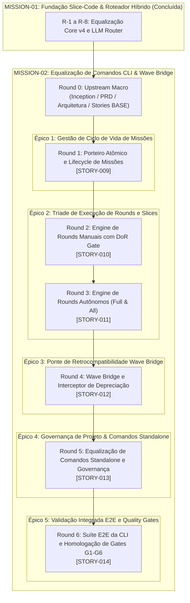

# Sequenciador Geral de Entregas — Bombe Code

## 1. Princípio Motor: Cadência Kanban 1 Round = 1 Story

O Bombe Code opera sob o modelo rigoroso de **1 Round = 1 Story**. 
- O **Round 0** é dedicado exclusivamente ao Upstream Macro (Lean Inception, PBB, PRD, Arquitetura e Sequenciamento Geral).
- Os **Rounds de Execução (1 a N)** são executados de forma sequencial e unívoca: cada round absorve exatamente uma história de ponta a ponta (Upstream Técnico da Story -> Fatiamento em Slices -> Queima TDD Downstream -> Code Review & Validação de DoD por @unclebob e @david).

---

## 2. Histórico Cumulativo de Missões

### MISSION-01: Fundação Slice-Code e Roteamento Híbrido (Baseline Entregue)
| Round | Story ID | Épico | Título da História | Status |
| :---: | :---: | :---: | :--- | :---: |
| **R-1** | `STORY-001` | `EP-01` | Migração de Configuração e Runtime Slice-Code | ✅ **DONE** |
| **R-2** | `STORY-002` | `EP-01` | Atualização dos Dossiês dos Agentes para PDW 4.0 | ✅ **DONE** |
| **R-3** | `STORY-003` | `EP-02` | Contrato LLMProviderProtocol e Adapter Local vLLM | ✅ **DONE** |
| **R-4** | `STORY-004` | `EP-02` | Classificador de Complexidade e Roteador Híbrido | ✅ **DONE** |
| **R-5** | `STORY-005` | `EP-02` | QuotaManager com Detecção de 429 e Failover | ✅ **DONE** |
| **R-6** | `STORY-006` | `EP-02` | FallbackToolParser para Extração Resiliente | ✅ **DONE** |
| **R-7** | `STORY-007` | `EP-03` | Motor de Execução Kanban e Tríade CLI Básica | ✅ **DONE** |
| **R-8** | `STORY-008` | `EP-04` | Teste E2E de Contingência Real com Cota Z.ai Esgotada | ✅ **DONE** |

---

## 3. Matriz de Sequenciamento da MISSION-02 (Rounds 1 a 6)

| Round | Story ID | Épico | Título da História | Complexidade | Agente | Dependências | Desbloqueio de Valor |
| :---: | :---: | :---: | :--- | :---: | :---: | :--- | :---: |
| **R-1** | `STORY-009` | `EP-01` | Porteiro Atômico e Lifecycle de Missões | Pleno (3h) | @barbara | Round 0 | Comandos `bombe mission new/status/end` com trava atômica no filesystem (WIP=1). |
| **R-2** | `STORY-010` | `EP-02` | Engine de Rounds Manuais com DoR Gate | Sênior (4h) | @barbara | `STORY-009` | Comandos `bombe round start/burn/review/validate/status` com parada mandatória na DoR. |
| **R-3** | `STORY-011` | `EP-02` | Engine de Rounds Autônomos (Full & All) | Sênior (4h) | @barbara | `STORY-010` | Comandos `bombe round full` (semi-auto) e `bombe round all` (hands-free contínuo). |
| **R-4** | `STORY-012` | `EP-03` | Wave Bridge e Interceptor de Depreciação | Pleno (3h) | @barbara | `STORY-011` | Interceptor para chamadas legadas `bombe wave <cmd>` com Rich warning e paridade 1:1. |
| **R-5** | `STORY-013` | `EP-04` | Equalização de Comandos Standalone e Governança | Pleno (3h) | @barbara | `STORY-012` | Comandos `project configure/ship`, `mode`, `task`, `rca`, `review`, `simplify`, `status-report`. |
| **R-6** | `STORY-014` | `EP-05` | Suíte E2E da CLI e Homologação de Gates G1-G6 | Pleno (3h) | @fowler | `STORY-013` | Cobertura integrada dos 19 entry points, zero stubs e validação dos gates G1-G6. |

---

## 4. Políticas Explícitas de Entrada e Saída (DOR & DOD de Round)

### 4.1 Definition of Ready (DoR) para Iniciar um Round
1. O Round imediatamente anterior deve estar no estado `validated` ou `done`, com 100% dos checklists marcados.
2. A Story do Round deve estar completamente especificada no formato canônico BASE em `docs/missions/02/stories/`.
3. Contratos de interface, dependências e critérios de aceite definidos sem ambiguidade.
4. Em modo manual (`round-start`), o orquestrador para determinística e obrigatoriamente no portão de Upstream aguardando comando de queima.

### 4.2 Definition of Done (DoD) para Concluir um Round
1. 100% dos Slices da Story foram executados via TDD estrito (Backend Red/Green/Refactor + Frontend Construction quando aplicável).
2. Zero testes quebrados na suíte de regressão automatizada (`pytest tests/`).
3. Zero stubs, mocks temporários ou `NotImplementedError` em código de produção (`src/bombe_code/`).
4. Code review aprovado por @hoare e homologação arquitetural por @unclebob no diff atômico da Story.
5. Artefatos de documentação e status atualizados em `mission.md` e na respectiva Story.
